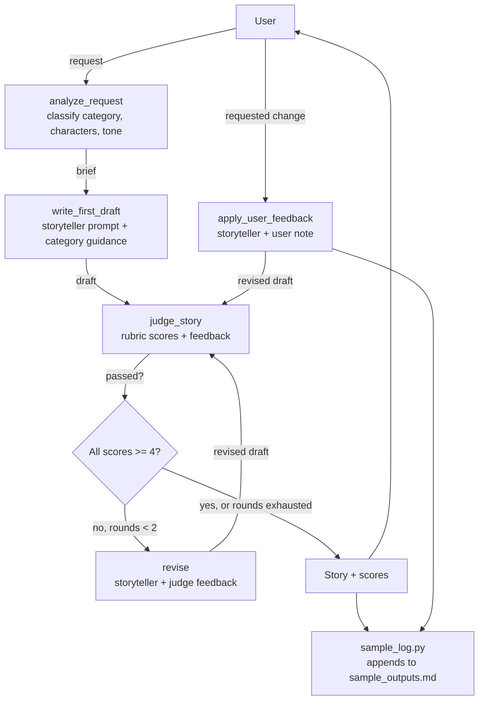

# Bedtime Story Agent

A small Python tool that turns a short request into a bedtime story for children aged 5 to 10. A judge model reviews each draft, and the storyteller revises it until it passes or the revision limit is reached. The user can then ask for changes.

## Quick start for reviewers

1. Install Python 3.9 or newer.
2. Install the dependencies:
   ```bash
   python -m venv .venv
   source .venv/bin/activate          # Windows PowerShell: .\.venv\Scripts\Activate.ps1
   pip install -r requirements.txt
   ```
3. Run the tests (no key needed): `python -m unittest discover -s tests -v`
4. Run the web app: `python app.py`, then open http://127.0.0.1:5000 and paste an Anthropic API key.
5. Or run the terminal version: `python main.py` (set `ANTHROPIC_API_KEY` first).

Step-by-step instructions for running, testing, and publishing are in `docs/STEPS.md`.

## Block diagram



Components:
- `main.py`: the command-line loop (input, output, feedback turns).
- `pipeline.py`: orchestrates the steps above.
- `prompts.py`: all prompt text and the story categories.
- `judge.py`: the LLM judge and its rubric.
- `llm.py`: the Anthropic client wrapper and JSON parsing.
- `app.py`: the Flask web server, security guards, and API routes.
- `keystore.py`: holds the API key in memory only.
- `tracing.py`: records each model call for the inspector.
- `sample_log.py`: appends each story and change to `sample_outputs.md`.
- `templates/`, `static/`: the web page, styles, and script.

## Setup

Requires Python 3.9 or newer. Dependencies: `anthropic` and `flask`.

```bash
python -m venv .venv
source .venv/bin/activate        # Windows: .venv\Scripts\activate
pip install -r requirements.txt
export ANTHROPIC_API_KEY="your-key-here"   # keep this out of the repo
```

Windows PowerShell: `.\.venv\Scripts\Activate.ps1` to activate, and `$env:ANTHROPIC_API_KEY="your-key-here"` for the key.

## Web UI (recommended)

The web app gives you a page for writing stories, a prompt inspector, and a log of every model call.

```bash
python app.py
```

Then open http://127.0.0.1:5000 in your browser.

- **Write:** type a request (or pick an example), then press Write story. The story, judge scores, and a verdict appear. Ask for changes in the box under the story.
- **Model calls:** expand "Model calls" to see each step (analyzer, first draft, judge, reviser) with its system prompt, user prompt, and output. Use this to judge prompt quality.
- **Prompts:** the Prompts tab shows every prompt template the agent uses. It sends no requests.
- **API key:** paste your key in the API key panel and press Save key. It is kept in the server's memory only. It is not written to disk, logged, or shown again. Restarting the server or pressing Forget key removes it. You can instead set `ANTHROPIC_API_KEY` in your terminal before starting, and the UI will use that.

Security measures:
- The server listens only on 127.0.0.1, so other machines on your network cannot reach it.
- It rejects requests whose Host or Origin is not localhost, which blocks DNS rebinding and cross-site requests.
- State-changing requests must include a custom header and a JSON body. Browsers cannot send these from another website without permission, which blocks cross-site request forgery.
- A Content Security Policy blocks inline scripts and third-party resources. The page sets `X-Frame-Options: DENY` and `nosniff`.
- All model output is inserted with `textContent`, never as HTML, so it cannot inject markup.
- Input is length-limited and control characters are removed. Request bodies are capped at 16 KB.
- The server allows 10 model calls per minute to limit spending if the page is left open or misused.
- API responses are marked `no-store`, and error messages never include the key.

Run the tests with `python -m unittest discover -s tests -v`. They include security checks such as rejecting bad hosts and missing headers and confirming the key never appears in a response.

## Run from the terminal (no UI)

This runs the original starter's flow, with the same pipeline.

```bash
python main.py
```

Example:

```
What kind of story do you want to hear? A story about a girl named Alice and her best friend Bob, who happens to be a cat.
```

Press Enter at the "Want any changes?" prompt to finish.

## Tests

The tests use a fake client, so they run without an API key and without network access:

```bash
python -m unittest discover -s tests -v
```

They check the analyzer, the pass and revision logic, the revision cap, fallback behavior for bad model output, and the web app's security guards. They do not check story quality. Story quality needs a live run with a real key.

## Model

The model is `claude-haiku-5-5`, set in `llm.py`. The original starter used GPT-3.5 Turbo through the OpenAI API. The assignment email asked for this change, so the project no longer uses OpenAI. See DECISIONS.md for the full list of changes.

## Design summary

- Requests are grouped into six categories, and each category has its own storyteller guidance.
- Each story follows a story arc: setup, problem, attempts, turning point, and calm resolution.
- The judge scores six criteria from 1 to 5. A story passes only if every score is 4 or higher.
- At most two automatic revision rounds run, to keep cost and latency bounded.
- The user can request changes, and each change goes through the same judge loop.

## Sample outputs

Stories and changes made in the web app are logged to `sample_outputs.md` automatically. Each new story becomes a sample, and each change becomes its own sample. The page shows a counter of how many samples the file holds, so you can see the total as you work.

The logger writes to that one file only. It never records the API key, and it cannot be pointed at another file from the browser. If the file can't be written, the story still appears, and the page says it was not logged. The terminal version (`main.py`) does not write samples.

The counter is marked temporary. To hide it, set `SAMPLE_COUNTER_VISIBLE = False` in `app.py`. To stop logging entirely, remove the `_log_sample` calls in `app.py`.

## Verification

- **Automated tests:** 47 tests pass without an API key (`python -m unittest discover -s tests -v`).
- **Live run:** the web app produced a complete story with judge scores and a reader-change revision using `claude-haiku-5-5`.
- **Samples:** `sample_outputs.md` holds six logged samples covering a calm-style animal story, a magic story, an everyday story, an adventure, a shy-monster edge case, and a reader-change revision.
- **Terminal entry point:** `python main.py` prints a clear message for a missing key or a rejected key.
- **Fresh install:** the project installs from `requirements.txt` into an empty virtual environment, and the tests pass there.
- **Key safety:** the project contains no real API key. `.env` and `.venv/` are excluded in `.gitignore`.
- **Screenshots:** `screenshots/` shows the page at desktop and phone widths, the Prompts tab, and the key-error and story-error states.
